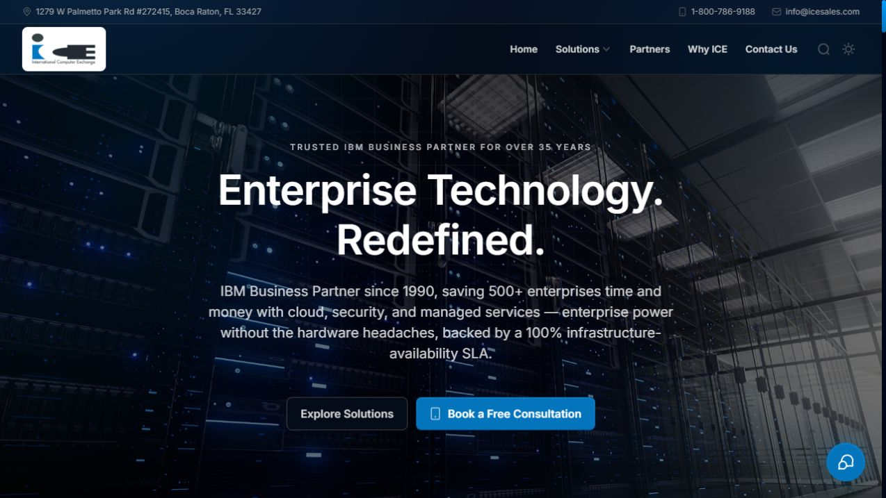
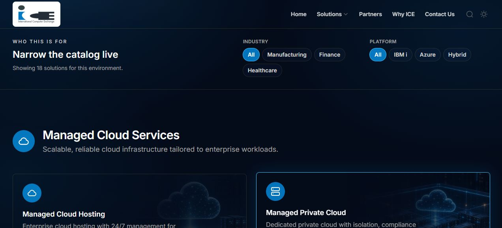
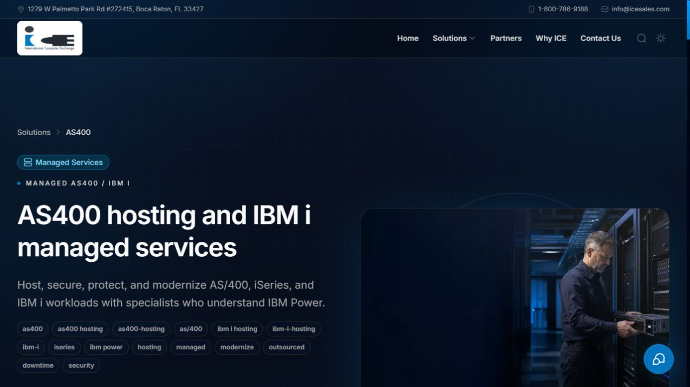
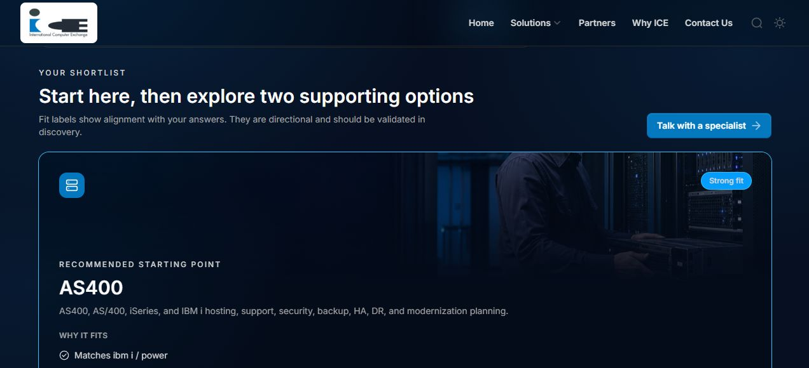

# International Computer Exchange Website

[](https://github.com/MDCran/ice-website/actions/workflows/security-checks.yml) [](https://github.com/MDCran/ice-website/actions/workflows/codeql.yml)

A Next.js website and content-management application for International Computer Exchange. The codebase combines public service pages, a filterable solutions catalog, a guided solution finder, and an administrative CMS backed by Supabase.

[Documented sandbox](https://sandbox.icesales.com/) · [Public routes](src/app/%28public%29) · [CMS implementation](src/lib/cms) · [Contributing](CONTRIBUTING.md)

## Engineering overview

- **Content-driven pages:** public routes read structured CMS content, with reusable sections and solution-page layouts.
- **Discovery:** a solutions catalog and guided finder help visitors explore service offerings.
- **Administration:** the codebase includes content editing, resource management, and access-page workflows.
- **Presentation:** responsive React components, motion effects, and Three.js visual elements.
- **Metadata:** shared SEO configuration, canonical URLs, structured data, sitemap, and social-image generation.

This README describes the tracked implementation. The screenshots and sandbox link are project references, not evidence of performance, conversion rates, or production-security certification.

## Stack and code map

Next.js 16, React 19, TypeScript, Tailwind CSS 4, Supabase Auth/PostgreSQL/Storage, Motion/GSAP, and Three.js. Exact dependencies and available scripts are in [package.json](package.json).

| Path | Responsibility |
| --- | --- |
| [src/app/(public)](src/app/%28public%29) | Public pages, catalog, and solution finder |
| [src/app/admin](src/app/admin) | Administrative interface |
| [src/app/api](src/app/api) | Server-side route handlers |
| [src/lib/cms](src/lib/cms) | CMS retrieval, page registry, and content composition |
| [src/lib/supabase](src/lib/supabase) | Browser, server, public-read, and privileged database clients |
| [src/lib/seo](src/lib/seo) | Shared metadata and URL utilities |
| [supabase/migrations](supabase/migrations) | Database evolution |
| [src/components](src/components) | Shared layout, content, and UI components |

## Website preview

Committed screenshots were captured from the documented sandbox.

### Homepage



### Solutions catalog



### AS400 and IBM i managed services



### Guided solution finder



## Local development

Requires Node.js 20.9 or newer, npm, and an isolated Supabase development project.

1. Install the locked dependencies with `npm ci`.
2. Create an uncommitted `.env.local` with your development project's `NEXT_PUBLIC_SUPABASE_URL` and `NEXT_PUBLIC_SUPABASE_ANON_KEY`. Server-side administrative features also use `SUPABASE_SERVICE_ROLE_KEY`; never prefix that key with `NEXT_PUBLIC_`.
3. Review [supabase-setup.sql](supabase-setup.sql), [SQL updates](sql), and [Supabase migrations](supabase/migrations) with the maintainer before initializing your development database. The repository does not provide a single fully automated environment/bootstrap command. Use synthetic data and keep production credentials and client documents out of local test fixtures.
4. Start the development server:

```bash
npm run dev
```

Open [localhost:3000](http://localhost:3000). Public routes live under `src/app/(public)` and update as source files change. Supabase-dependent pages and administrative features require the corresponding schema, policies, and account setup.

Additional integrations have their own server-side configuration. Do not point a development checkout at production systems to satisfy missing settings.

## Validation and security checks

```bash
npm run lint
npm run build
# After a successful build:
npm start
```

A focused [SEO audit script](scripts/test-seo-audit.mjs) checks URL handling and service-content definitions. It imports TypeScript directly and requires a Node runtime capable of loading those files. It is not wired into an npm test script or the checked-in workflows; the repository has no general application test command.

- [CodeQL](.github/workflows/codeql.yml) analyzes JavaScript/TypeScript on pushes, pull requests, and a weekly schedule.
- [Security checks](.github/workflows/security-checks.yml) installs dependencies, runs `npm audit --audit-level=high`, and checks whitespace.
- npm audit is **non-blocking** (`continue-on-error: true`). A green badge may still accompany dependency advisories; inspect the [workflow logs](https://github.com/MDCran/ice-website/actions/workflows/security-checks.yml).
- These workflows do not run lint, an application build, browser tests, or a deployment verification. They are useful checks, not a guarantee of application security.

## Administrative operations

The existing demo administrator reset workflow is available to authorized maintainers from a trusted checkout:

```bash
npm run admin:reset-password -- --email admin-demo@icesales.com
```

The command reads local Supabase configuration from `.env.local`, generates a temporary password, verifies it, and prints it once. Change that temporary password immediately under **Admin Center → Settings**. Do not copy it into issues, commits, screenshots, or logs.

Resetting any other address is blocked by the script; manage personal administrators in the Admin Center instead. Omit `--password` whenever possible so a chosen password is not retained in shell history.

### Access pages

**Admin Center → Access Pages** manages proposal content, attached private documents, publication state, and recipient links. Raw link secrets, passwords, and client documents must never be committed to this repository. Evaluate these features only with authorized accounts and synthetic documents.

## Framework and deployment references

The app uses [next/font](https://nextjs.org/docs/app/getting-started/fonts) with Inter and [Geist](https://vercel.com/font).

- [Next.js documentation](https://nextjs.org/docs)
- [Learn Next.js](https://nextjs.org/learn)
- [Next.js source](https://github.com/vercel/next.js)
- [Next.js deployment documentation](https://nextjs.org/docs/app/getting-started/deploying)
- [Vercel](https://vercel.com/new)

Deployment requires the matching environment, database migrations, storage policies, and integration configuration. A hosting build alone does not validate those services. Follow [CONTRIBUTING.md](CONTRIBUTING.md) for contribution and attribution guidance.
